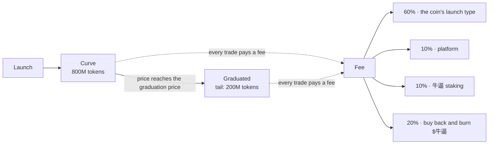

# Introduction

**English** · [中文](../zh/introduction.md)

**牛逼 (niúbī)** is how you say *awesome* in Chinese. 牛 is the bull: bull-run energy, red and gold. **Awesome** is
the launchpad built around it, and **$牛逼** is its token.

## What Awesome does

- **Launch a coin in one transaction.** Name, ticker, picture, links and an optional first buy. The coin exists,
  trades and has a chart the moment the transaction lands.
- **Liquidity that can never be pulled.** On the EVM chains every coin has a fixed supply of 1,000,000,000 tokens,
  all of it locked forever in one pool shaped like a bonding curve. No one, not even Awesome, can withdraw it.
- **No migration.** When an EVM coin graduates it keeps trading in the same pool. There is no migration moment to
  snipe or rug. On Solana, coins launch on Pump.fun or Raydium LaunchLab and follow those venues' curves.
- **You decide where the creator fees go.** Every coin picks a [launch type](launch-types.md): keep the fees, buy
  back and burn the coin, buy and burn $牛逼, pay the holders, or split them with a team.
- **Many chains, one site.** BNB Chain, Base, Arbitrum, HyperEVM, Monad, X Layer, Elysium, Robinhood Chain, Arc and
  Solana, all on [niúbī.xyz](https://xn--nib-9na0w.xyz). You can even pay for a launch on one chain with coins from
  another.
- **Everything in one Feed.** New launches, graduations, big buys, posts from the community and X posts from the
  accounts that move the market.

## How a coin lives (EVM chains)

1. **Launch.** The coin is created and its whole supply goes into its pool: 800M on the curve, 200M in the tail.
2. **Curve.** Buyers walk the price up the curve. The coin page shows its progress to graduation.
3. **Graduation.** When the curve has raised its target (16 BNB on BNB Chain, about $11,000 on the other EVM chains),
   the coin graduates and keeps trading in the same pool, against the tail.
4. **Fees.** Every trade pays a small fee. 60% follows the coin's launch type; the rest funds the platform, 牛逼
   staking and the $牛逼 buyback and burn. See [Fees](fees.md).

## Who it is for

- **Creators** who want a fair launch with locked liquidity, and a say in what their fees do.
- **Traders** who want coins that can't be rugged by pulling liquidity, with charts, holders and trades in one place.
- **$牛逼 holders**: every chain feeds the $牛逼 buyback and burn.
- **Builders** who want an open [API, SDK and contracts](developers.md).

Next: [Getting started](getting-started.md).
