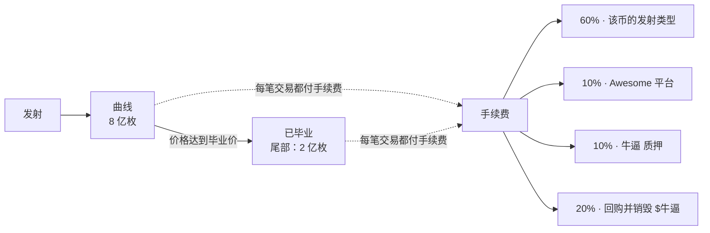

# 简介

[English](../en/introduction.md) · **中文**

**牛逼（niúbī）** 就是英文里的 *awesome*。牛是公牛：牛市的劲头，红与金。**Awesome** 是围绕它打造的发射台，**$牛逼** 是它的代币。

## Awesome 能做什么

- **一笔交易发射一个币。** 名称、代号、图片、链接，外加可选的首笔买入。交易一上链，币就已经存在、可以交易，并且有 K 线。
- **流动性永远撤不走。** 在 EVM 链上，每个币的总量固定为 1,000,000,000 枚，全部永久锁在一个联合曲线形状的池子里。谁都提不走，包括
  Awesome 自己。
- **无需迁移。** EVM 链上的币毕业后继续在同一个池子里交易，没有迁移这个时间点，自然也没法借机狙击或跑路。在 Solana 上，币在 Pump.fun
  或 Raydium LaunchLab 上发射，沿用这些平台各自的曲线。
- **创建者手续费去哪儿，你说了算。** 每个币都要选一个[发射类型](launch-types.md)：手续费自己拿、回购并销毁本币、买入并销毁 $牛逼、分给持有人，或者和团队分成。
- **多条链，一个网站。** BNB Chain、Base、Arbitrum、HyperEVM、Monad、X Layer、Elysium、Robinhood Chain、Arc 和 Solana，全都在
  [niúbī.xyz](https://xn--nib-9na0w.xyz) 上。你甚至可以用另一条链上的币，为某条链上的发射付款。
- **一个动态看全部。** 新发射、毕业、大单买入、社区帖子，以及那些能带动行情的账号发的推特。

## 一个币的生命周期（EVM 链）

1. **发射。** 币被创建，全部供应量进入它的池子：曲线上 8 亿枚（800M），尾部 2 亿枚（200M）。
2. **曲线。** 买家沿着曲线把价格一路推高。币的页面会显示距离毕业的进度。
3. **毕业。** 当曲线募集到目标金额（BNB Chain 上为 16 BNB，其他 EVM 链约 $11,000），币就毕业了，并继续在同一个池子里对着尾部流动性交易。
4. **手续费。** 每笔交易都会收一点手续费。60% 按该币的发射类型分配；其余部分给 Awesome 平台、牛逼 质押，以及回购并销毁 $牛逼。详见[手续费](fees.md)。

## 适合谁

- **创建者**：想要流动性锁死的公平发射，并且想决定自己的手续费用来做什么。
- **交易者**：想要无法通过撤池子跑路的币，K 线、持有人和成交记录一页看全。
- **$牛逼 持有人**：每条链都在为 $牛逼 的回购和销毁输血。
- **开发者**：想要开放的 [API、SDK 和合约](developers.md)。

下一步：[快速上手](getting-started.md)。
